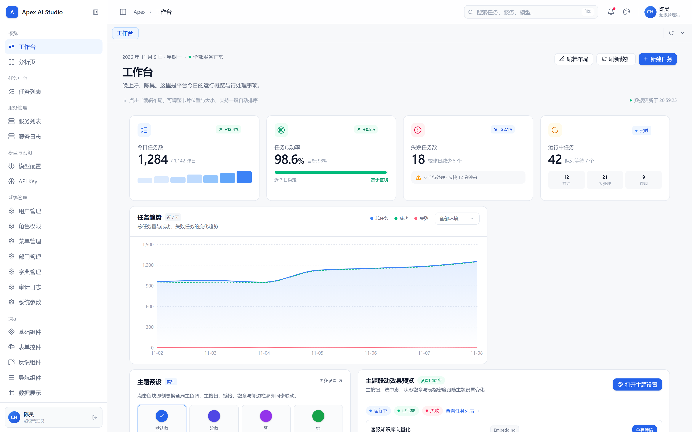
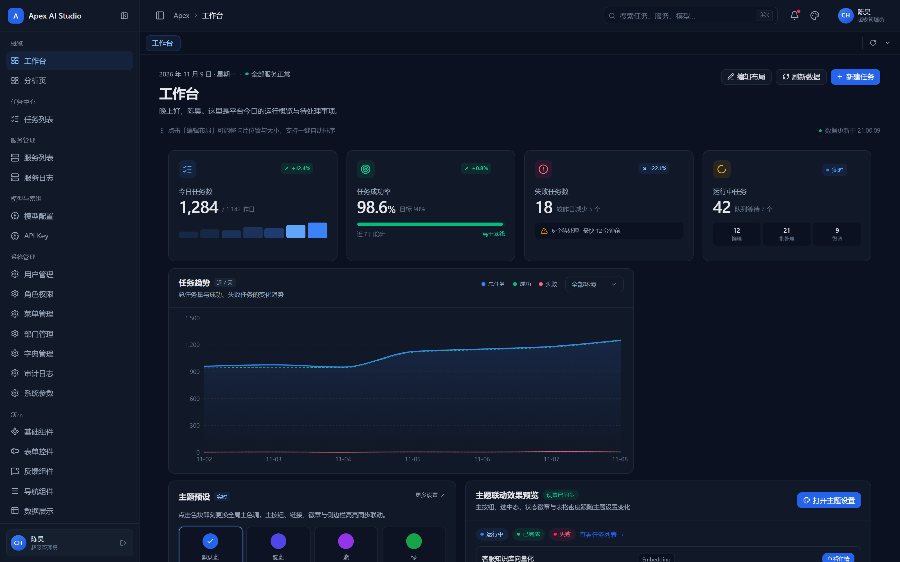
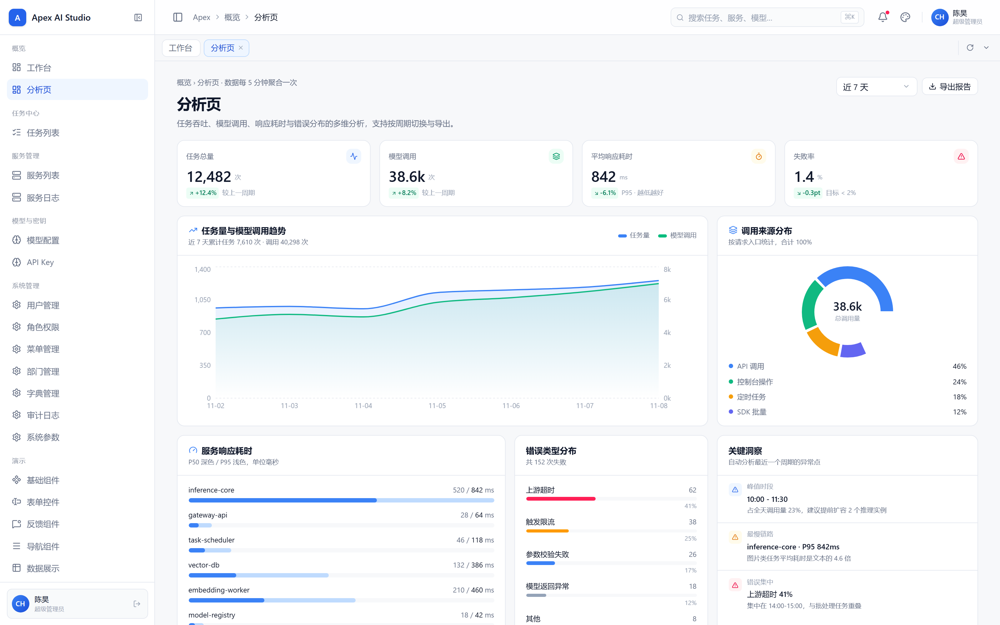
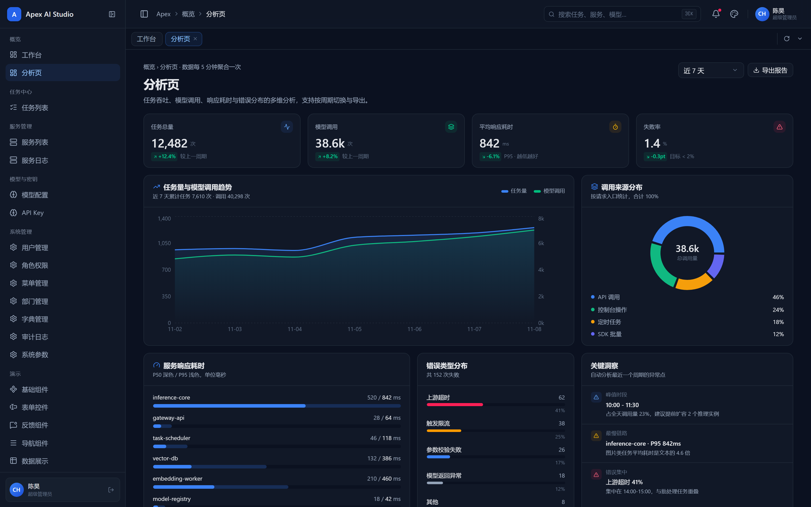
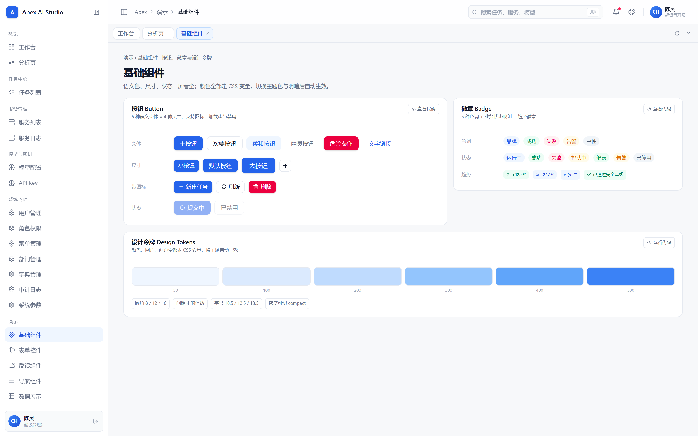
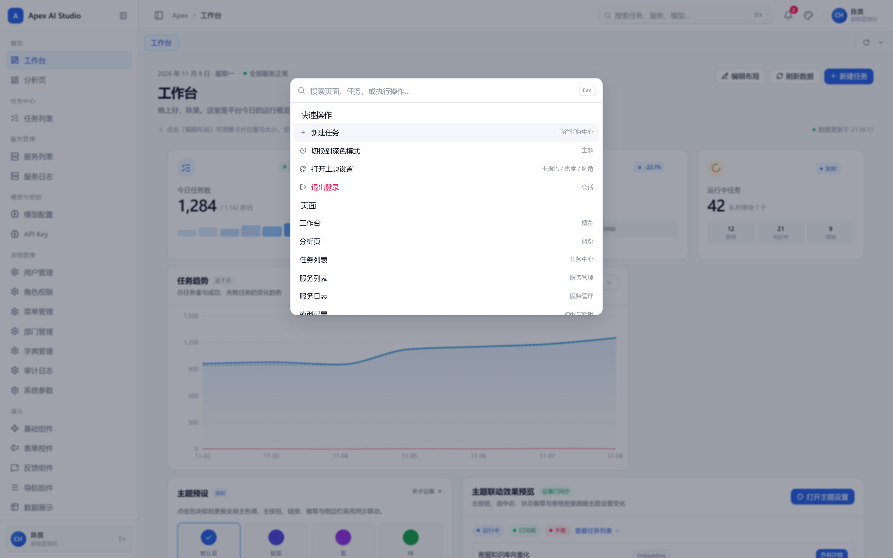
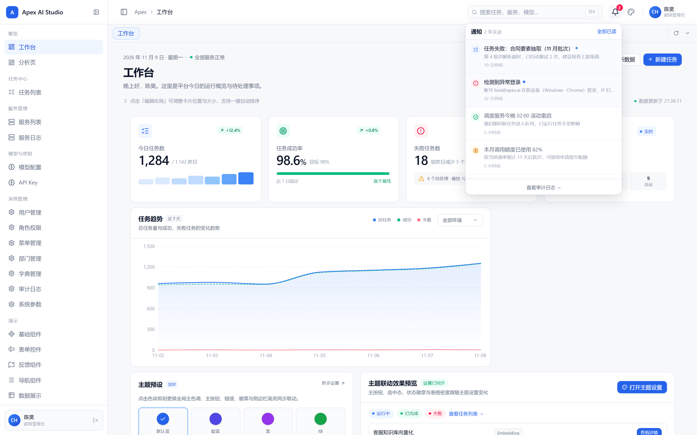

# Apex Admin

开箱即用的后台管理前端模板：**React 19 + TanStack Router + Base UI + Tailwind v4**。
内置权限、主题、多页签、可拖拽工作台与 mock/live 双模数据层，clone 下来直接写业务，不用再搭一遍架子。



## 特性

- **32 条路由开箱可用**：工作台、分析页、任务、服务、模型、系统管理（用户 / 角色 / 菜单 / 部门 / 字典 / 审计 / 参数）、个人中心、异常页（403 / 404 / 500 / 离线）。
- **权限到按钮级**：26 个权限码、3 个角色，路由守卫 + 菜单过滤 + `<Can>` 组件三层拦截，一条权限码同时驱动菜单显隐和按钮禁用。
- **主题系统**：5 套主题色 × 明暗模式 × 紧凑密度 × 三档圆角 × 侧边栏深色，全部走 CSS 变量，切换即时生效并持久化。
- **可拖拽工作台**：卡片自由换位、拖角缩放、一键自动排序（消除空洞的重排算法），布局存服务端偏好。
- **多页签导航**：右键菜单支持刷新 / 关闭左右 / 关闭其他 / 关闭全部 / 复制路径，固定页签不可关闭，会话级持久化。
- **全局命令面板**：`⌘K` / `Ctrl+K` 唤起，一次搜索页面、任务与快捷操作（切换主题、退出登录），结果按当前角色权限过滤。
- **通知中心**：未读数字徽标、单条与全部已读、跳转关联页面，接入后端只需换掉一个 hook。
- **组件演示 + 业务示例**：5 个组件演示页（基础 / 表单 / 反馈 / 导航 / 数据展示）＋ 4 个可改造示例（列表 CRUD、表单校验、分步流程、状态占位）。
- **数据层双模**：开发期走内存 mock，零后端依赖；上线切 `live` 走真实 API，**页面与 hooks 零改动**。
- **类型严格**：TS strict + 零 `any`，`pnpm typecheck` 全绿。

## 截图

| 深色工作台 | 分析页 |
| --- | --- |
|  |  |

| 深色分析页 | 组件演示 |
| --- | --- |
|  |  |

| 命令面板（⌘K） | 通知中心 |
| --- | --- |
|  |  |

## 技术栈

| 层 | 选型 |
| --- | --- |
| 构建 | Vite 7 + TypeScript 5（strict） |
| 框架 | React 19 |
| 路由 | TanStack Router（文件路由，类型安全） |
| 数据 | TanStack Query + TanStack Table |
| 组件 | Base UI（无样式原语）+ Tailwind CSS v4 + CVA |
| 状态 | Zustand（含 persist） |
| 图表 | Recharts |
| 布局 | react-grid-layout |
| 反馈 | sonner / cmdk / Lucide |

## 快速开始

### 从模板创建新项目

```bash
# GitHub 模板仓（需对模板仓有读权限）
gh repo create my-admin --template ingkele/apex-admin --private --clone
```

也可以在仓库页面点「Use this template」。仓库转为公开后，还可以：

```bash
npx degit ingkele/apex-admin my-admin
```

创建后按 [CONTRIBUTING.md](CONTRIBUTING.md) 的「改造清单」过一遍品牌名、权限码与 `.env`。

### 本地开发

```bash
pnpm install
pnpm dev        # http://127.0.0.1:5180
pnpm build      # 生产构建
pnpm typecheck  # tsc --noEmit
pnpm routes     # 打印路由树
```

> **端口约定**：`vite.config.ts` 固定 `host: 127.0.0.1` + `port: 5180` + `strictPort: true`。
> 用 `127.0.0.1` 而不是 `localhost`（部分环境把 `localhost` 解析到 `::1`，工具走 IPv4 会连不上）。
> 端口被占时 Vite 直接报错而非漂移，用 `netstat -ano | findstr :5180` 查占用后清掉旧实例。

mock 模式下任意邮箱 + 至少 4 位密码即可登录，角色由邮箱前缀决定：

| 邮箱前缀 | 角色 | 能力 |
| --- | --- | --- |
| `admin@` | admin | 全部权限 |
| `ops@` | operator | 业务读写，无系统管理 |
| 其他 | viewer | 只读 |

## 项目结构

```
src/
├── app.config.ts          # 全局配置唯一真源：权限码、导航分组、角色表
├── styles/index.css       # 主题 token 唯一真源（CSS 变量 + @theme 映射）
├── stores/                # Zustand：theme / auth / sidebar / tabs / ui
├── lib/                   # http.ts（Transport 抽象）/ route-meta / format / utils
├── api/index.ts           # Query hooks + queryKeys（页面不直连 transport）
├── mocks/                 # db.ts（内存数据）+ transport.ts（正则路由表）
├── components/
│   ├── ui/                # 原子控件（Base UI 底层）
│   ├── shared/            # 业务组件（DataTable / FilterBar / PageHeader / Can / ThemeDrawer）
│   └── layout/            # Sidebar / Topbar / TabBar
└── routes/                # 文件路由（routeTree.gen.ts 自动生成，勿手改）
```

## 核心设计

### 数据流只有一条链路

```
页面（routes） → api hooks → transport → mocks | live
```

不允许跨层直连。切换后端只替换 transport 实现，页面无需改动。

### 权限模型

角色 → 权限码 → UI/路由，映射表在 `app.config.ts`：

- 路由级：`_auth.tsx` 的 `beforeLoad` 校验登录态
- 菜单级：`sidebar.tsx` 按权限码过滤 `NAV_GROUPS`
- 组件级：`<Can code="task:create">` 包裹按钮或区块

### 主题系统

`styles/index.css`（token）→ `stores/theme.store.ts`（色阶 + applyTheme）→ `theme-drawer.tsx`（入口）。
新增主题色只需在 `ACCENTS` 加一组 10 档色阶，抽屉色板自动出现。

### Mock → Live

`lib/http.ts` 的 `Transport` 抽象由 `VITE_DATA_MODE` 控制：

| 模式 | 行为 |
| --- | --- |
| `mock`（默认） | 走 `mocks/transport.ts` 内存路由，零后端依赖（上传/流式有模拟通道） |
| `live` | 走 axios 实例：自动带 Bearer token、15s 超时、错误归一化为 `ApiError` |

切换只需 `.env` 设 `VITE_DATA_MODE=live` 与 `VITE_API_BASE_URL`（可选 `VITE_API_TIMEOUT` 调超时，毫秒）。

请求能力清单（`lib/http.ts` 单点收敛）：

| API | 用途 |
| --- | --- |
| `http.get/post/put/del` | 常规 CRUD（TanStack Query hooks 内部调用） |
| `http.upload(path, formData, onProgress)` | 文件上传，带进度回调 |
| `http.download(path, filename)` | 文件下载，Blob 触发浏览器落盘 |
| `http.stream(path, { onChunk, onDone, signal })` | SSE / 流式响应（AI 对话逐字输出、日志推流） |
| `http.raw` | axios 原始实例，自定义 config 场景（拦截器仍生效） |

## 对接后端

前后端唯一耦合点是 **HTTP DTO**，契约由后端 OpenAPI 提供：

1. 后端更新 OpenAPI
2. 前端 `openapi-typescript` 生成类型，落到 `api/index.ts`
3. 同步 `mocks/db.ts` 与 `mocks/transport.ts`（**必须与真实响应体同构**）
4. 改页面

字段命名大小写敏感，改任一接口须三处同步核对，详见 [CONTRIBUTING.md](CONTRIBUTING.md)。

## 贡献

见 [CONTRIBUTING.md](CONTRIBUTING.md)：目录硬边界、新模块接入五步、提交规范、改造清单。

## 许可证

[MIT](LICENSE)
